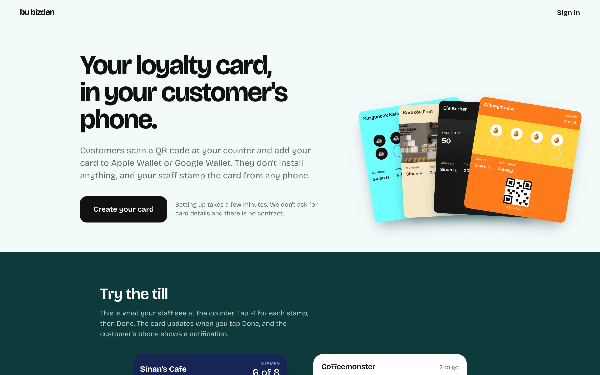
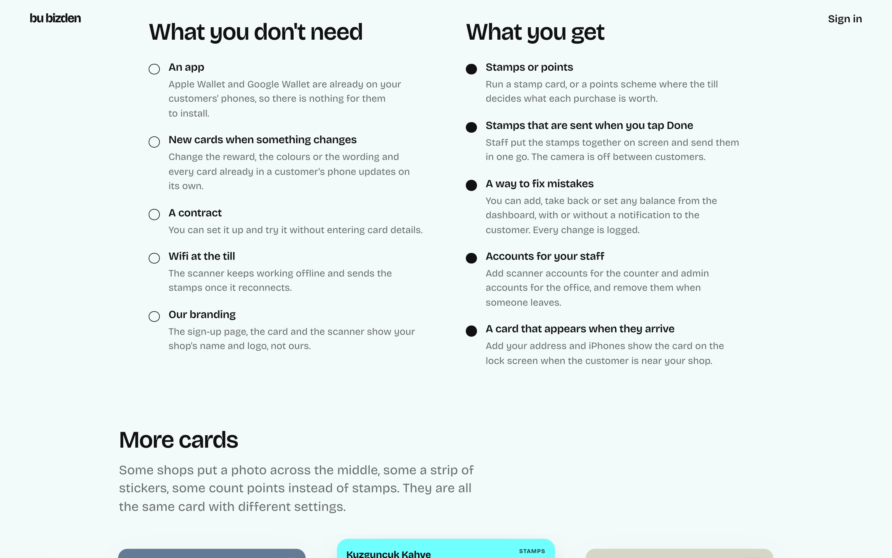
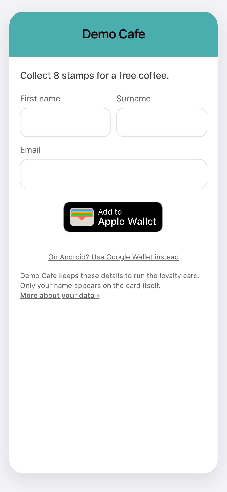
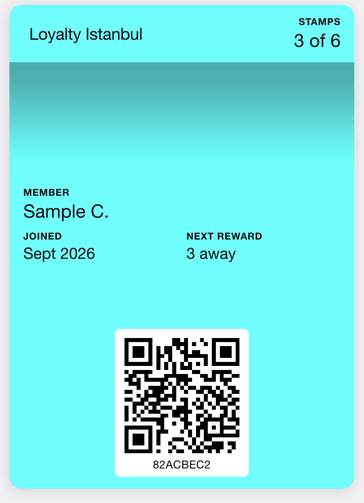
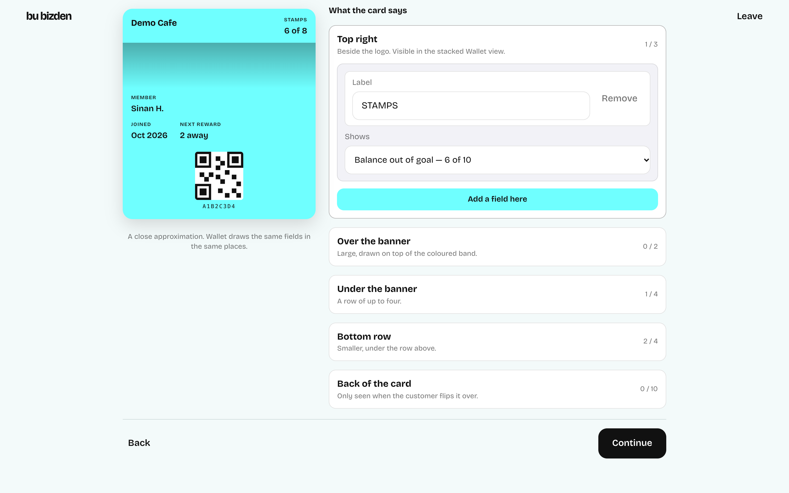
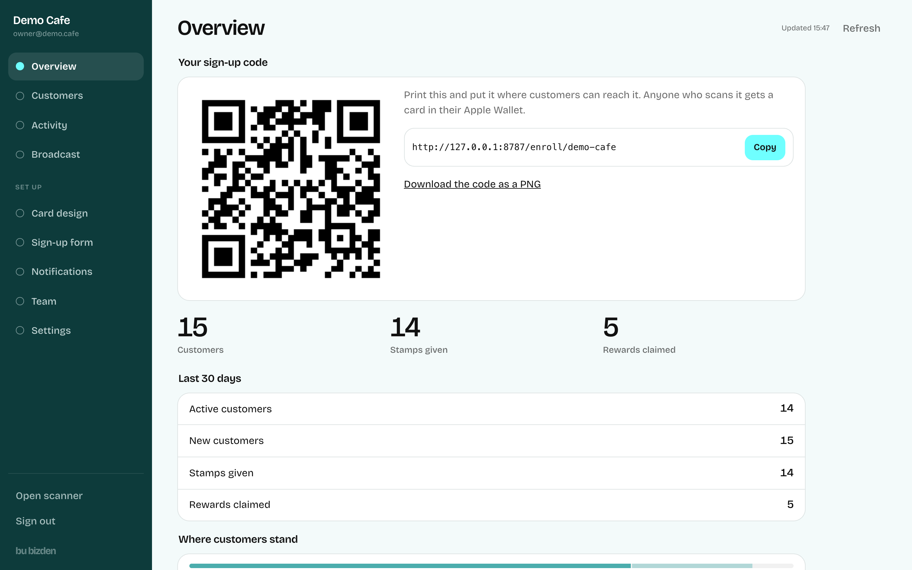
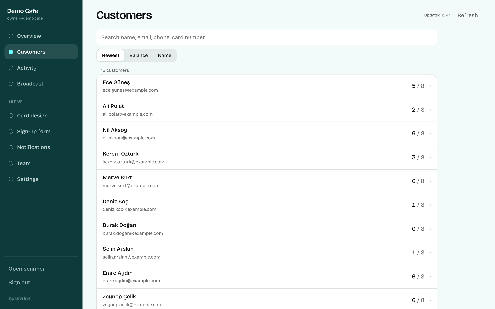
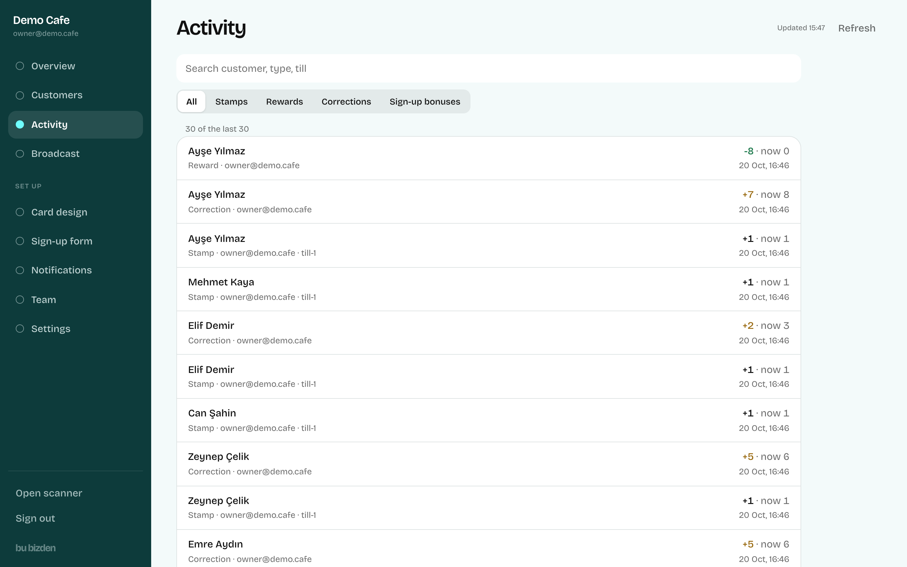
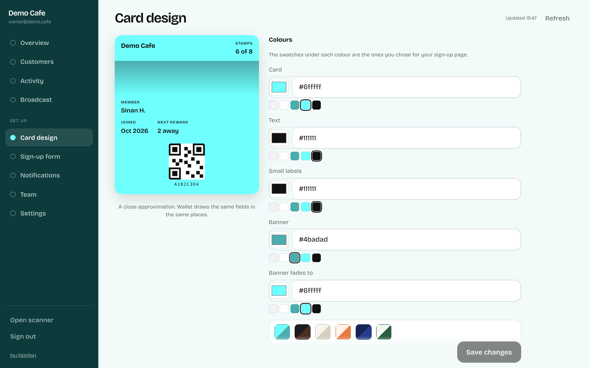
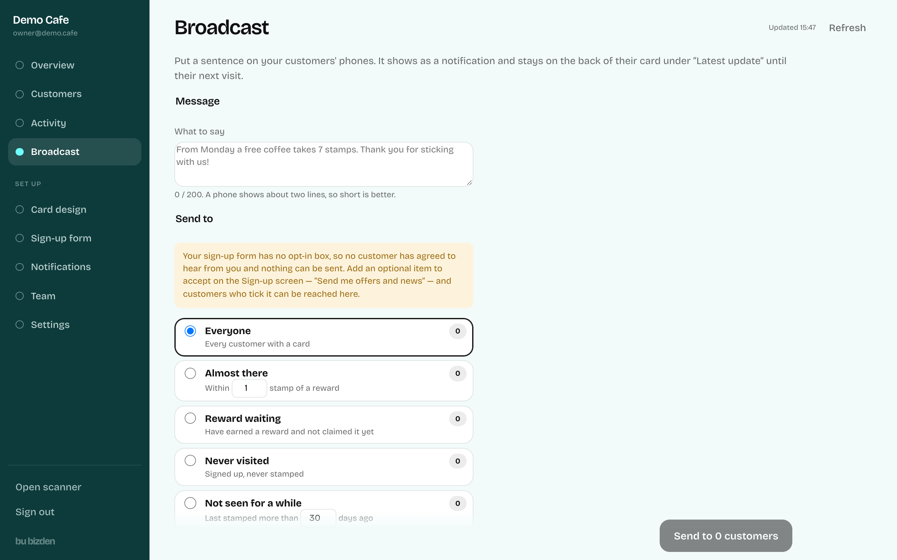

# Bu bizden — loyalty cards in Apple Wallet and Google Wallet

A multi-tenant SaaS that lets any café or shop run a digital stamp card without an app: customers scan a QR at the counter, get a pass in their phone's wallet, and the card updates over the air every time staff stamp it.

**Live at [bubizden.co](https://bubizden.co)** — in production at a café in Istanbul since September 2026.

> **About this repository.** The product's source code is private. This repo is a technical showcase: real screenshots, an architecture write-up, and a handful of unmodified source files from the production codebase that illustrate how it is built. Nothing here is runnable on its own.

## What it does

| Role | What they see |
|---|---|
| **Shop owner** | Signs up on a self-serve wizard, picks stamps or points, designs the card, chooses what the sign-up form asks for, and gets a printable QR. Runs everything from a dashboard afterwards. |
| **Customer** | Scans the QR, fills in a short form, taps *Add to Apple Wallet* (or Google Wallet on Android). No app install. The card updates within seconds of each stamp, with a lock-screen notification. |
| **Barista** | Opens a browser-based scanner on any phone or iPad, scans the card's QR, taps +1 / Done. Works offline and syncs when the wifi is back. |

## Results

- **In production** since 21 September 2026, serving a real café's customers daily.
- **Apple Wallet and Google Wallet** from one codebase, behind a single `WalletProvider` interface.
- **828 automated tests** (604 backend: unit + integration against the Firestore emulator; 224 web), all green, plus an end-to-end lifecycle check driven by `curl`.
- **KVKK (Turkish GDPR) compliant** sign-up: per-shop consent items, versioned legal texts, 18+ check, opt-in gated broadcasts.
- Stamp requests answer in ~100 ms at the counter; pass updates reach iPhones in about a second on wifi.

## Screenshots

All screenshots were taken from the real application running against the Firebase emulators with synthetic data.

**Landing page and the interactive "try the till" demo**





**Customer sign-up page (iPhone) and the generated Wallet pass**

<p>
  
  
</p>

**Self-serve onboarding: the card designer step**



**Owner dashboard**











## Key features

- **Self-serve onboarding** — shop name, programme (stamps or points), sign-up form, card design, location, account. Everything is editable later.
- **Card designer** — colours, logo/banner upload (resized in the browser to Apple's exact sizes), and data-driven card fields. The browser preview and the `.pkpass` builder run the *same* rendering code, so what the owner sees is what Wallet draws.
- **Over-the-air updates** — APNs pushes for Apple (empty payload, the device re-fetches the pass from the web service), REST PATCH for Google. Lock-screen messages on stamp and on broadcast.
- **Broadcasts** — send a sentence to "everyone", "one stamp away", "not seen for 30 days", etc. Gated by marketing opt-in.
- **Barista scanner** — PWA, WASM QR decoding (iOS Safari has no `BarcodeDetector`), offline queue with idempotent replay, Turkish/English UI.
- **Owner dashboard** — metrics, customer search, append-only activity log, balance corrections (silent or notified), team management with role-based accounts, settings.
- **Multi-tenant from day one** — `shopId` on every document, query and auth claim; one Pass Type ID serves every shop.
- **Geofenced cards** — the pass surfaces on the lock screen near the shop.

## Tech stack

| Layer | Choice |
|---|---|
| Backend | Node 20, TypeScript (run via type-stripping, no build step), Fastify, Zod |
| Data | Firestore (transactions + append-only audit log), Firebase Auth with custom claims |
| Wallets | Apple PassKit (`.pkpass` signing, APNs over HTTP/2 with certificate auth, PassKit Web Service), Google Wallet REST API + signed JWT save links |
| Frontend | React 18, Vite, hand-rolled router, PWA with service worker, `zxing-wasm` |
| Infra | Cloud Run (`min-instances=1`), Firebase Hosting rewrites (one origin, no CORS), Secret Manager, Cloud Storage, Docker |
| Testing | `node --test` + Firestore/Auth emulators, Vitest + Testing Library, architecture tests that enforce module boundaries |

## Architecture in brief

```
┌──────────────┐   HTTPS    ┌───────────────────────────────────────────┐
│ Web app      │ ─────────▶ │ pass-service (Fastify on Cloud Run)       │
│ /start /scan │            │                                           │
│ /admin       │            │  http/      routes, Zod, auth, rate limit │
└──────────────┘            │  domain/    enroll · stamp · redeem · ... │
                            │             (no wallet imports allowed)   │
┌──────────────┐            │  wallet/    WalletProvider interface      │
│ Apple Wallet │ ◀────────▶ │    ├─ appleProvider  → apple/ (pkpass,    │
│ Google Wallet│  push/fetch│    ├─ googleProvider      APNs, web svc)  │
└──────────────┘            │    └─ routingProvider → google/ (REST)    │
                            │  firestore/ Admin SDK, converters         │
                            └───────────────────┬───────────────────────┘
                                                │ transactions
                                          ┌─────▼─────┐
                                          │ Firestore │  clients denied entirely;
                                          └───────────┘  only the service writes
```

Six rules the whole codebase is built around:

1. **Firestore is the source of truth; the pass is a cached view.** No balance is ever read from a pass or a request body.
2. **Pass updates are best-effort and asynchronous.** A push failure never fails a stamp.
3. **Every mutation is transactional and idempotent.** The transaction id is derived from a client-generated idempotency key, so a double-tap on café wifi lands on the same row.
4. **Every mutation appends an audit row.** The balance is derived; the log wins if they disagree.
5. **Domain code must not know what a `.pkpass` is.** Enforced by a test, not by convention — see [`examples/test/architecture.test.ts`](examples/test/architecture.test.ts).
6. **`shopId` on every document, query and claim.**

A longer write-up, including the Wallet behaviours that only a real device can teach you, is in [docs/ARCHITECTURE.md](docs/ARCHITECTURE.md).

## Example source files

Unmodified files from the production codebase, chosen because each shows one design decision clearly.

| File | Why it is here |
|---|---|
| [`examples/wallet/provider.ts`](examples/wallet/provider.ts) | The seam between domain logic and any wallet platform. Returns outcomes instead of throwing, by contract. |
| [`examples/wallet/routingProvider.ts`](examples/wallet/routingProvider.ts) | How Google Wallet was added without touching a single Apple call site. |
| [`examples/domain/rules.ts`](examples/domain/rules.ts) | The loyalty scheme as pure functions: cooldowns, awards, redemption arithmetic. No database, no clock. |
| [`examples/apple/apns.ts`](examples/apple/apns.ts) | HTTP/2 APNs client with certificate auth, and the headers that decide whether a pass update survives a phone being offline. |
| [`examples/http/rateLimit.ts`](examples/http/rateLimit.ts) | Per-address brakes on the unauthenticated endpoints, and why they count failures rather than requests. |
| [`examples/test/architecture.test.ts`](examples/test/architecture.test.ts) | Tests that fail the build if domain code imports a platform module, or if any TypeScript syntax needs a compile step. |
| [`examples/scripts/lifecycle.sh`](examples/scripts/lifecycle.sh) | The end-to-end checkpoint: enroll → scan → stamp → replay → cooldown → redeem → audit, over `curl`. |
| [`examples/firestore.rules`](examples/firestore.rules) | Every client denied everything, and the reasoning. |

## Development workflow (private repo)

For context on how the real project is run day to day:

```bash
npm run emulator        # Firestore + Auth emulators
npm run dev             # pass service on :8787
cd web && npm run dev   # web app on :5173
npm run lifecycle       # 28 end-to-end checks over curl
npm test                # 828 tests (integration tests skip without the emulator)
./deploy.sh api|web|rules
```

The Cloud Run image is built locally with Docker and pushed to Artifact Registry; certificates come from Secret Manager at runtime and are never baked into the image.

## Author

Sinan Halefoğlu — [github.com/sinanhalef](https://github.com/sinanhalef)

Copyright © 2026. All rights reserved. The product's source code is not open source; the excerpts in this repository are published for portfolio purposes only.
